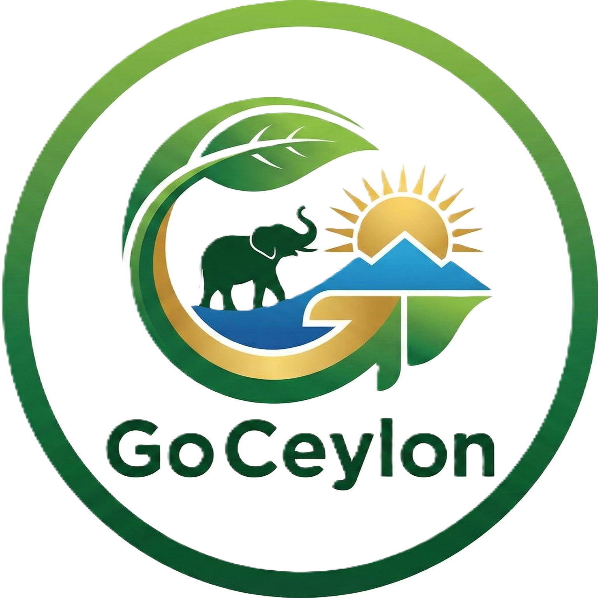

# 🌴 GoCeylon — Sri Lanka Tour & Travel Experience

<p align="center">
  
</p>

<p align="center">
  <strong>An immersive, high-performance web application showcasing the wonders of Sri Lanka.</strong><br />
  Curated travel experiences, tour packages, destination spotlights, and seamless responsive design.
</p>

<p align="center">
  <a href="#-key-features">Key Features</a> •
  <a href="#-tech-stack">Tech Stack</a> •
  <a href="#-project-structure">Project Structure</a> •
  <a href="#-getting-started">Getting Started</a> •
  <a href="#-tour-packages--destinations">Tour Packages</a> •
  <a href="#-author--contact">Author</a>
</p>

<p align="center">
  
  
  
  
  
</p>

---

## 📖 Overview

**GoCeylon** is a modern, single-page tourism application engineered with **React 19**, **Tailwind CSS 4**, and **Vite 7**. Designed to inspire travelers across the globe, the platform delivers rich visual storytelling through curated destinations (Sigiriya, Kandy, Ella, Yala, Mirissa), transparent pricing packages, interactive animations via **AOS (Animate On Scroll)**, and smooth one-page navigation with **React Scroll**.

Whether accessed from desktop, tablet, or smartphone, GoCeylon offers an ultra-fluid, engaging experience that captures the cultural heritage, wildlife, hill country, and pristine coastlines of the Pearl of the Indian Ocean.

---

## ✨ Key Features

| Feature | Description |
| :--- | :--- |
| 🏝️ **Immersive Hero Experience** | High-impact full-screen visual hero banner featuring dynamic typography (*Fahkwang* + *Poppins*) and call-to-action triggers. |
| 🧭 **Smooth Anchor Navigation** | Header with blur-backdrop on scroll and animated single-page scrolling powered by `react-scroll`. |
| 📱 **Mobile-First Responsive Menu** | Fullscreen animated slide-down navigation drawer with locked body-scroll for zero layout shifts. |
| 🗺️ **Destination Showcases** | Grid-based destination cards spotlighting Sri Lanka’s cultural and natural landmarks with gradient overlays and interactive hover effects. |
| 📦 **Tour Package Catalog** | Data-driven card architecture displaying package durations, pax capacity, prices, and highlighted itineraries. |
| ⚡ **Fluid AOS Scroll Animations** | Scroll-triggered entrance animations (zoom, fade, slide) tailored for high frame-rate performance. |
| 🛡️ **Value & Trust Pillars** | Highlights certified guides, registered agency credentials, and 24/7 bilingual traveler support. |
| 📬 **Interactive Lead Generation** | Integrated newsletter subscription banner and interactive contact section with quick links and social profiles. |

---

## 🛠️ Tech Stack

### Core Framework & Build Tools
- **[React 19](https://react.dev/)** — Modern React architecture leveraging functional components and hooks.
- **[Vite 7](https://vite.dev/)** — Blazing-fast HMR (Hot Module Replacement) and optimized production bundler.
- **[Tailwind CSS 4](https://tailwindcss.com/)** — Next-generation engine with native CSS imports and utility layer extensions.

### UI Libraries & Animation
- **[AOS (Animate On Scroll)](https://michalsnik.github.io/aos/)** — Lightweight scroll-triggered animations.
- **[React Scroll](https://www.npmjs.com/package/react-scroll)** — Smooth, offset-aware anchor navigation.
- **[React Icons](https://react-icons.github.io/react-icons/)** — Popular icon collections including FontAwesome, Remix, and Ionicons.
- **Google Fonts** — Styled with **Fahkwang** (display/headings) and **Poppins** (body copy).

---

## 📁 Project Structure

```text
GoCeylon/
├── public/
│   └── logo.png                # Brand logo & browser favicon
├── src/
│   ├── assets/                 # High-resolution WebP images & graphics
│   │   ├── hero.webp           # Hero banner imagery
│   │   ├── about1.webp ...     # About & story visuals
│   │   ├── service1.webp ...   # Destination showcase assets (Sigiriya, Ella, etc.)
│   │   ├── packages1.webp ...  # Tour package cards assets
│   │   └── cta1.webp ...       # Call-to-action background imagery
│   │
│   ├── sections/               # Modular UI page sections
│   │   ├── Header.jsx          # Dynamic navbar with scroll blur & mobile drawer
│   │   ├── Hero.jsx            # Hero section with primary CTA
│   │   ├── About.jsx           # Agency story, stats, and highlights
│   │   ├── Services.jsx        # Destinations grid with video-play indicators
│   │   ├── CtaOne.jsx          # Mid-page promotional banner
│   │   ├── Packages.jsx        # Tour pricing cards generated from dataset
│   │   ├── Features.jsx        # Why choose us / trust guarantees
│   │   └── Footer.jsx          # Newsletter form, sitemap & contact info
│   │
│   ├── export.js               # Centralized data model (Packages, Features, Guides)
│   ├── index.css               # Design system tokens, Google Fonts & Tailwind imports
│   ├── App.jsx                 # Master page layout component
│   └── main.jsx                # Application root rendering entry point
│
├── eslint.config.js            # Code quality and linting configuration
├── index.html                  # HTML5 document skeleton & meta definitions
├── package.json                # Project dependencies, metadata, and scripts
└── vite.config.js              # Vite configuration with Tailwind CSS plugin
```

---

## 🚀 Getting Started

Follow these steps to run the application locally on your machine.

### Prerequisites

Ensure you have the following installed:
- **Node.js** (v18.0.0 or higher recommended) — [Download Node.js](https://nodejs.org/)
- **npm** (bundled with Node.js) or **yarn** / **pnpm**

### Installation

1. **Clone the repository:**
   ```bash
   git clone https://github.com/umindudinal/GoCeylon.git
   ```

2. **Navigate to the project root:**
   ```bash
   cd GoCeylon
   ```

3. **Install dependencies:**
   ```bash
   npm install
   ```

4. **Launch the local development server:**
   ```bash
   npm run dev
   ```

5. **Open in your browser:**
   ```text
   http://localhost:5173
   ```

---

## 📜 Available Scripts

In the project root, you can run:

| Command | Action |
| :--- | :--- |
| `npm run dev` | Starts the Vite development server with Hot Module Replacement (HMR). |
| `npm run build` | Compiles and optimizes assets into the `dist/` directory for production. |
| `npm run preview` | Locally serves the production build from `dist/` to verify performance. |
| `npm run lint` | Runs ESLint to check for code style issues and potential bugs. |

---

## 🗺️ Tour Packages & Destinations

GoCeylon features fully configurable itineraries managed through `src/export.js`:

### Featured Tour Packages

| Package Name | Duration | Group Size | Price | Highlights |
| :--- | :---: | :---: | :---: | :--- |
| **Cultural Triangle Explorer** | 4D / 3N | Up to 7 | **$69** | Sigiriya Rock, Dambulla Caves & Kandy Temple |
| **Hill Country Scenic Journey** | 2D / 4N | Up to 10 | **$79** | Nuwara Eliya tea estates, Ella train & waterfalls |
| **Wildlife Safari Adventure** | 7D / 4N | Up to 12 | **$99** | Yala National Park leopards, elephants & camping |
| **South Coast Beach Escape** | 8D / 2N | Up to 14 | **$85** | Mirissa surfing, whale watching & Galle Fort |
| **Ultimate Sri Lanka Highlights** | 1D / 2N | Up to 3 | **$299** | VIP private island tour spanning highlights |
| **East Coast Beach & Culture** | 9D / 3N | Up to 13 | **$79** | Trincomalee, Nilaveli beach & Koneswaram |

### Popular Destinations Covered
- 🏛️ **Sigiriya** — 5th-century ancient citadel & UNESCO World Heritage wonder
- 🛕 **Kandy** — Sacred city & Temple of the Tooth Relic
- 🚂 **Ella** — Nine Arch Bridge, Little Adam's Peak & misty hiking trails
- 🐆 **Yala** — World-renowned wildlife sanctuary with high leopard density
- 🏖️ **Mirissa & Galle** — Golden beaches, whale migrations & Dutch colonial ramparts
- 🌊 **Trincomalee** — Serene turquoise waters of Nilaveli & Pigeon Island

---

## 🎨 Design System & Customization

### Typography
- **Headings & Display:** `Fahkwang` (Geometric & contemporary)
- **Body & Paragraphs:** `Poppins` (Readable & clean sans-serif)

### Adding New Packages or Content
All package data is decoupled from the UI. To add, edit, or remove packages, open `src/export.js`:
```javascript
export const Tourpackages = [
  {
    name: "Your New Tour Name",
    about: "Detailed description of the destination and activities.",
    btn: "View Tour Detail",
    price: "$120",
    days: "5D/4N",
    pax: "8",
    image: pakgCustomImage,
  },
  // ...
];
```

---

## 👨‍💻 Author & Contact

**Umindu Dinal**

- **GitHub:** [@umindudinal](https://github.com/umindudinal)
- **Email:** [umindudinal@gmail.com](mailto:umindudinal@gmail.com)
- **Phone:** +97 77 964 8818

---

## 📄 License

This project is licensed under the **MIT License**. Feel free to use this codebase for personal and educational projects.

<p align="center">
  <sub>Made with 🇱🇰 passion for Sri Lanka Tourism.</sub>
</p>
